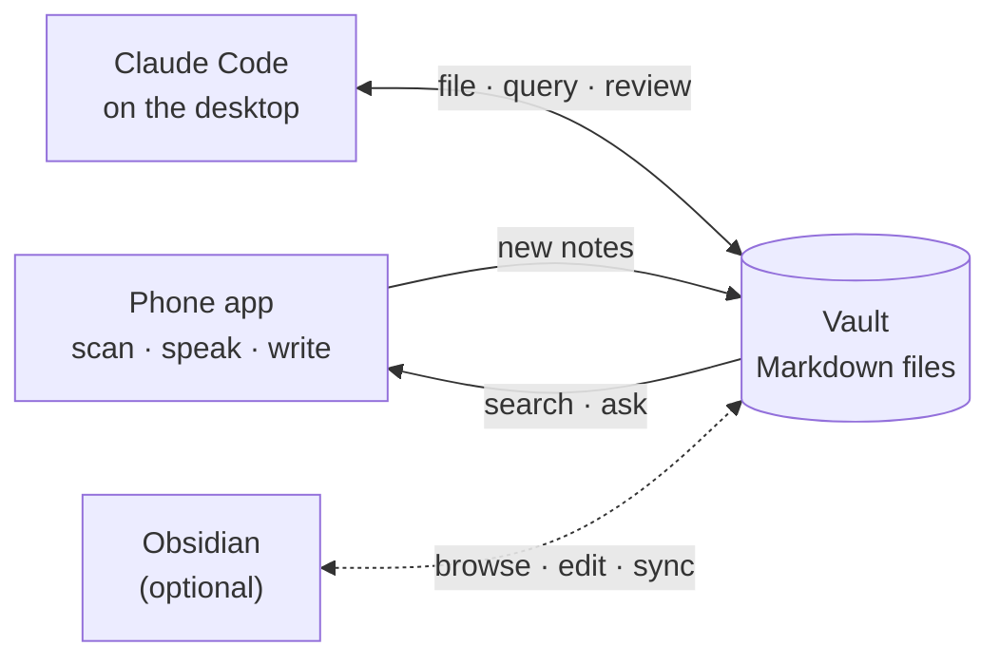
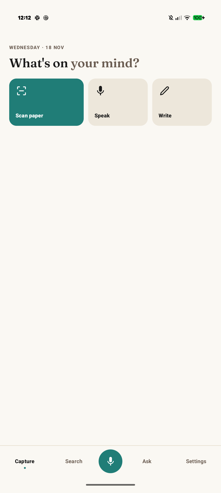
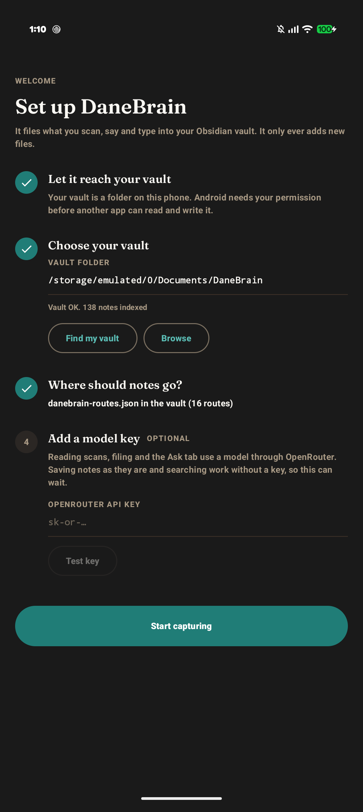

# DaneBrain

[](https://github.com/danehage/danebrain/actions/workflows/build.yml)

A personal knowledge setup in three parts:

1. **A vault.** A folder of Markdown notes with a simple structure. [Obsidian](https://obsidian.md) is a good way to browse and sync it, and is optional.
2. **Claude on the desktop.** [Claude Code](https://claude.com/claude-code) runs inside the vault folder to file, find and summarize notes.
3. **A phone app.** An Android app that scans paper, takes dictation and typed notes, files them into the vault, and searches and answers questions about it.

Everything is plain files in one folder. There is no server and no database, and each part works without the others.



<p>
  
  
  
  
</p>

New to this? Start at part 1. Already have a folder of notes, in Obsidian or not? Skip to [part 3](#3-the-phone-app); the app works with any folder of Markdown files.

## 1. The vault

A vault is nothing more than a folder of plain Markdown files. Because the notes are ordinary files, any program can read and write them: a text editor, Claude, the phone app. The rest of this setup depends on that, and on nothing else.

[`vault-starter/`](vault-starter/) is an empty vault you can copy. Its structure:

| Folder | What goes there |
|---|---|
| `00-Inbox/` | Captures you have not sorted yet. |
| `10-Projects/` | Things with an end: a trip, a renovation, an application. |
| `20-Areas/` | Things without an end: finances, health, home, family. |
| `30-Resources/` | Reference material by topic: quotes, recipes, whatever you collect. |
| `40-Archive/` | Finished projects and notes you no longer need in view. |
| `50-Daily/` | One note per day. |
| `60-Templates/` | Templates for common note types. |
| `90-Attachments/` | Images and scans. |

This is the PARA method (Projects, Areas, Resources, Archive) with an inbox and daily notes. The numbers only fix the order in the sidebar. A few conventions keep it searchable by people and by models: kebab-case filenames, ISO dates, and a small block of YAML at the top of each note giving its `type` and `status`.

**Set it up**

Copy `vault-starter/` to where you keep documents and rename it, for example `MyVault`. That is the whole setup: you now have a vault.

**Where Obsidian fits**

[Obsidian](https://obsidian.md) is a free app for reading and writing a folder like this, and the conventions here (`[[links]]` between notes, frontmatter, `![[image]]` embeds) are the ones it uses. Nothing in this setup requires it. It earns its place for three things:

- **Browsing and editing by hand.** Rendered notes, clickable links, backlinks, and table views over frontmatter.
- **Sync.** To have the vault on your phone and your computer, something has to sync the folder. [Obsidian Sync](https://obsidian.md/sync) is the paid, built-in way and is what this setup was built around. Any folder sync works instead, such as Syncthing.
- **Templates and daily notes.** One tap to create today's note from a template.

To use it, install Obsidian, choose **Open folder as vault**, and pick your folder. The starter vault includes three small Obsidian settings so attachments, new notes and daily notes land in the right folders.

On Android, keep the vault in device storage (for example `Documents/MyVault`), not inside another app's private storage, or the phone app in part 3 cannot reach it.

## 2. Claude in the vault

Claude Code is a terminal program. Started inside the vault folder, it can read, search and write the notes, which turns "where did I put that" and "what did I do this week" into questions you can just ask.

Two files in the starter vault tell it how to behave:

- [`CLAUDE.md`](vault-starter/CLAUDE.md) is the operating manual: the folder structure, the note conventions, and the rules (file captures properly, never invent what is not in the notes, cite sources as links, archive instead of deleting, keep your words separate from its own).
- [`AGENTS.md`](vault-starter/AGENTS.md) is a short brief about you and where things live. The phone app reads this file too, so the desktop and the phone answer from the same brief.

It also ships two skills in `.claude/skills/`:

- **weekly-review** reads the week's daily notes, sorts the inbox, proposes lessons worth keeping, and asks before changing anything.
- **summarize-article** turns a link into a summary note in the inbox.

**Set it up**

1. Install [Claude Code](https://claude.com/claude-code).
2. Open `AGENTS.md` and `CLAUDE.md` in the vault and replace the "fill this in" lines with a few facts about you.
3. In a terminal, `cd` into the vault and run `claude`.

Things to try:

- "File this: the plumber quoted 400 for the bathroom tap, valid until the end of the month."
- "What is in my inbox, and where should each note go?"
- "Summarize everything I know about the kitchen renovation."
- "Run my weekly review."

## 3. The phone app

Notes get lost between having a thought and sitting down at a computer. The app closes that gap and puts the vault in your pocket.

- **Scan paper.** Photograph a bill, a handwritten page or a label. A vision model reads it and proposes a title, a destination folder and the key fields. You review it, then it is written to the vault with the scan embedded.
- **Speak.** In-app dictation with the phone's own speech recognizer. It keeps listening through pauses.
- **Write.** A full-page editor. Save the text as it is with no model call, or let the model title and file it.
- **Share.** Send text, links or images to it from any other app.
- **Review.** Captures are read in the background; a notification tells you when one is ready, and tapping it opens the review.
- **Search.** Instant offline full-text search over every note.
- **Read.** Notes open in a built-in reader with headings, lists, tables, embedded scans and tappable links between notes. If the folder is an Obsidian vault, one tap opens the same note there.
- **Ask.** Chat with a model that can search the vault and read notes. Answers cite the notes they came from.

Rules it holds to:

- **Create only.** It creates new files. It never edits, moves or deletes anything already in the vault, and never writes to Obsidian's `.obsidian/` settings folder.
- **Never lose a capture.** A scan or note is saved on the phone the moment it is taken, and waits in a queue if there is no signal or the model fails.
- **Code decides paths.** The model picks a route and proposes a title; the app maps that to a folder and filename.

**Requirements**

- Android 11 or newer, with Google Play services (the document scanner uses ML Kit).
- A folder of Markdown notes in shared device storage, for example `Documents/MyVault`. It does not have to be an Obsidian vault.
- An [OpenRouter](https://openrouter.ai) API key for scanning, filing and Ask. Saving notes as they are and searching work without one. Any OpenAI-compatible service can be used instead by changing the API address in Settings.

The app asks for all-files access, because it has to read and write an arbitrary vault folder. That permission is why it is installed from a file and is not on the Play Store.

**Set it up**

1. Download the APK from [Releases](https://github.com/danehage/danebrain/releases) on the phone and open it. Allow installing from your browser when asked.
2. Follow the setup screen: grant access, choose the vault, pick where notes go, and add a key.

### Filing routes

A route is a folder plus a sentence telling the model when to use it. Routes live in a file named `danebrain-routes.json` at the top of your vault, so they are your data and not part of the app. The starter vault includes [one that matches its folders](vault-starter/danebrain-routes.json).

Without that file the app files everything into one inbox folder that you pick, and never creates any other folder. Settings has a button that writes a first routes file from your vault's own top-level folders.

```json
{
  "inbox": { "folder": "00-Inbox", "type": "note", "status": "inbox", "datePrefix": true,
             "when": "quick thoughts and anything that does not clearly fit another route" },
  "recipes": { "folder": "30-Resources/recipes", "type": "recipe", "status": "to-try",
               "tags": ["recipe"], "when": "recipes and cooking ideas" }
}
```

| Field | Meaning |
|---|---|
| `folder` | Vault-relative folder. Required. |
| `when` | When the model should pick this route. Required. |
| `type`, `status` | Written to the note's frontmatter. |
| `tags` | Tags added to every note on this route. |
| `datePrefix` | Start the filename with the capture date. |
| `format` | `note` (default), `document` (bills and invoices, with extracted fields) or `wine-bottle` (an example of a custom note layout). |
| `hub`, `hubReason` | Adds a line linking the note to a hub note, with the reason. |
| `wordsHeading` | Heading over your own words in a `wine-bottle` note. Default "In my words". |

The route named `inbox` is the fallback. Scans go to `scans/<year>/` inside your attachment folder: the one set in Obsidian if you use it, otherwise an existing attachments folder, otherwise a new `Attachments`.

### Privacy

- Scans and typed text are sent to the model you choose when you ask for filing. Ask sends your question, `AGENTS.md`, and the notes the model chooses to read.
- On OpenRouter, requests are limited to providers that do not retain or train on prompts. With a custom API address, what is kept is up to that service.
- Dictation uses the phone's speech recognizer, on-device where the phone supports it.
- The API key is encrypted with a key held in the Android Keystore.

### Limits

- The app does not sync anything itself; whatever syncs your folder carries new notes to your other devices. With Obsidian Sync that happens only while Obsidian is open on the phone, so for Obsidian vaults the home screen counts notes saved since Obsidian was last open, and Settings can add a "Sync Obsidian" button to your home screen that opens Obsidian on the vault.
- The built-in reader covers everyday Markdown. Obsidian plugin output, such as Dataview queries, shows as plain text.
- The Ask conversation is lost when the app is closed.
- The route table is edited as a file, not in the app.
- A personal project, tested on one phone.

## Building the app

Needs JDK 17 or newer and the Android SDK (platform 35). Create `local.properties` with `sdk.dir=` pointing at the SDK; it is not checked in.

```
./gradlew :app:testDebugUnitTest :app:assembleDebug
```

The APK lands at `app/build/outputs/apk/debug/app-debug.apk`. On Windows use `gradlew.bat`. [SPEC.md](SPEC.md) has the design.

A debug build is signed with a key tied to the computer that built it. For builds that install over each other from anywhere, create your own key and point the build at it from your user-level `~/.gradle/gradle.properties`:

```
DANEBRAIN_KEYSTORE=/path/to/your-release.jks
DANEBRAIN_KEYSTORE_PASSWORD=...
DANEBRAIN_KEY_ALIAS=...
```

Then build with `:app:assembleRelease`. Keep the key and password out of the repository and back them up: a build signed with a different key will not install over the app until it is uninstalled, which clears its queue and settings.

| Path under `app/src/main/java/app/danebrain/` | Contents |
|---|---|
| `core/` | Filing logic with no Android dependencies: slugs, YAML, routes, note layouts, vault writer. Covered by unit tests. |
| `data/` | Settings, capture queue, search index, image handling, vault access. |
| `work/` | Background analysis of queued captures. |
| `chat/` | Chat loop with read-only vault tools. |
| `net/` | Model API client. |
| `ui/` | Compose screens. |

## Making it yours

The name is the author's. If you fork this, change as much or as little as you like:

| To change | Edit |
|---|---|
| The name shown on the phone | `app_name` in `app/src/main/res/values/strings.xml`. This one line is enough for most people. |
| The app's identity, so it installs as a separate app | `applicationId` in `app/build.gradle.kts`, and the three `targetPackage` values in `app/src/main/res/xml/shortcuts.xml` to match. |
| The routes filename looked for in the vault | `ROUTES_FILE` in `app/src/main/java/app/danebrain/data/Vault.kt`, and rename the file in your vault. |
| The colors and title font | `app/src/main/java/app/danebrain/ui/Theme.kt`. |
| The launcher icon | `ic_launcher_foreground.xml` and `ic_launcher_monochrome.xml` in `app/src/main/res/drawable/`, and `ic_launcher_background` in `values/colors.xml`. |
| The vault structure | Rename or delete folders freely, then update the folder tables in `CLAUDE.md` and `AGENTS.md` and the `folder` values in `danebrain-routes.json`. |

The Kotlin package (`app.danebrain`) and the `DANEBRAIN_` signing property names never appear to a user and can stay. To rename the package too, use Android Studio's Refactor → Rename on the package and update `namespace` in `app/build.gradle.kts`.

## License

[MIT](LICENSE). The title font is Fraunces, under the [SIL Open Font License](licenses/Fraunces-OFL.txt).
