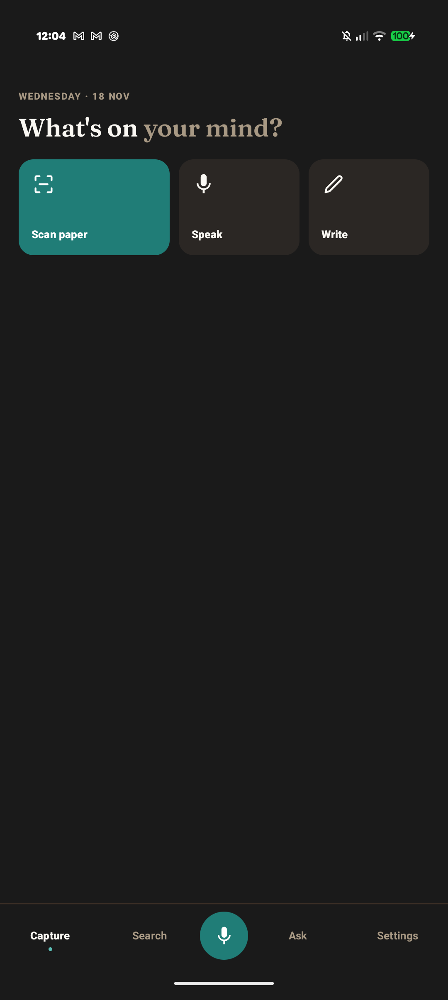
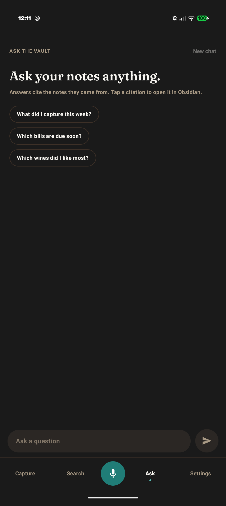
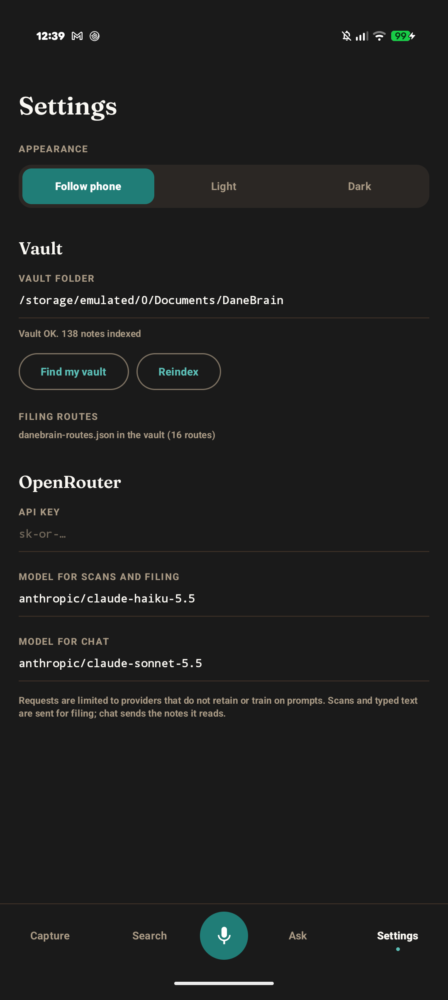

# DaneBrain

A small Android companion for an [Obsidian](https://obsidian.md) vault. Scan paper, dictate or type a note, and it lands in the vault as a properly filed Markdown note. It also searches the vault offline and answers questions about it through an LLM.

The app reads and writes the vault folder on the phone directly. It needs no server and no Obsidian plugin. If you use Obsidian Sync, new notes reach your other devices the next time Obsidian is open on the phone.

<p>
  
  
  
  
</p>

## What it does

- **Scan paper.** Photograph a bill, a handwritten page or a wine label. A vision model reads it and proposes a title, a destination folder and the key fields. You review it, then it is written to the vault with the scan embedded.
- **Speak.** In-app dictation with the phone's own speech recognizer. It keeps listening through pauses.
- **Write.** A full-page editor. Save the text raw to the inbox with no model call, or let the model title and file it.
- **Share.** Send text, links or images to it from any other app.
- **Search.** Instant offline full-text search over every note; results open in Obsidian.
- **Ask.** Chat with a model that can search the vault and read notes. Answers cite the notes they came from.

A few rules it holds to:

- **Create only.** It creates new files. It never edits, moves or deletes anything already in the vault, and never writes to `.obsidian/`.
- **Never lose a capture.** A scan or note is saved on the phone the moment it is taken, and waits in a queue if there is no signal or the model fails.
- **Code decides paths.** The model picks a route and proposes a title; the app maps that to a folder and filename.

[SPEC.md](SPEC.md) has the full design.

## Requirements

- Android 11 or newer, with Google Play services (the document scanner uses ML Kit).
- An Obsidian vault in shared device storage, for example `Documents/MyVault`. A vault kept in Obsidian's private app storage cannot be read by other apps and has to be moved first.
- An [OpenRouter](https://openrouter.ai) API key for scanning, filing and chat. Saving raw text and searching work without one.

The app asks for all-files access, because it has to walk and write an arbitrary vault folder. That permission is why this is a sideloaded app and not a Play Store one.

## Build

Needs JDK 17 or newer and the Android SDK (platform 35). Create `local.properties` with `sdk.dir=` pointing at the SDK; it is not checked in.

```
./gradlew :app:testDebugUnitTest :app:assembleDebug
```

The APK lands at `app/build/outputs/apk/debug/app-debug.apk`. On Windows use `gradlew.bat`.

### Signed release builds

A debug build is signed with a key tied to the computer that built it. To get builds that install over each other from anywhere, create your own key and point the build at it from your user-level `~/.gradle/gradle.properties`:

```
DANEBRAIN_KEYSTORE=/path/to/your-release.jks
DANEBRAIN_KEYSTORE_PASSWORD=...
DANEBRAIN_KEY_ALIAS=...
```

Then build with `:app:assembleRelease`. Keep the key and password out of the repository and back them up: a build signed with a different key will not install over the app until it is uninstalled, which clears its queue and settings.

## Install and first run

Copy the APK to the phone and open it, or use `adb install -r <apk>`.

1. Open the Settings tab and grant all-files access.
2. Tap **Find my vault**.
3. Paste an OpenRouter API key.

## Filing routes

A route is a destination in the vault plus a sentence telling the model when to use it. The app bundles a sample table in [`app/src/main/assets/routes.json`](app/src/main/assets/routes.json). To use your own, put a file named `danebrain-routes.json` at the top level of your vault; the Settings tab shows which table is in use.

```json
{
  "inbox": { "folder": "00-Inbox", "type": "note", "status": "inbox", "datePrefix": true,
             "when": "quick thoughts and anything that does not clearly fit another route" },
  "recipes": { "folder": "30-Resources/recipes", "type": "recipe", "status": "to-try",
               "tags": ["recipe"], "when": "recipes and cooking ideas" }
}
```

| Field | Meaning |
|---|---|
| `folder` | Vault-relative folder. Required. |
| `when` | When the model should pick this route. Required. |
| `type`, `status` | Written to the note's frontmatter. |
| `tags` | Tags added to every note on this route. |
| `datePrefix` | Start the filename with the capture date. |
| `format` | `note` (default), `document` (bills and invoices, with extracted fields) or `wine-bottle`. |
| `hub`, `hubReason` | Adds a line linking the note to a hub note, with the reason. |
| `wordsHeading` | Heading over your own words in a wine note. Default "In my words". |

The route named `inbox` is the fallback. Scan images go to `90-Attachments/scans/<year>/`.

## Making it yours

The name is the author's. If you fork this, change as much or as little as you like:

| To change | Edit |
|---|---|
| The name shown on the phone | `app_name` in `app/src/main/res/values/strings.xml`. This one line is enough for most people. |
| The app's identity, so it installs as a separate app | `applicationId` in `app/build.gradle.kts`, and the three `targetPackage` values in `app/src/main/res/xml/shortcuts.xml` to match. |
| The routes filename looked for in the vault | `ROUTES_FILE` in `app/src/main/java/app/danebrain/App.kt`. |
| The colors and title font | `app/src/main/java/app/danebrain/ui/Theme.kt`. |
| The launcher icon | `app/src/main/res/drawable/ic_launcher.xml`. |

The Kotlin package (`app.danebrain`) and the `DANEBRAIN_` signing property names never appear to a user and can stay. To rename the package too, use Android Studio's Refactor → Rename on the package and update `namespace` in `app/build.gradle.kts`.

## Privacy

- Scans and typed text are sent to the model you choose on OpenRouter when you ask for filing. Chat sends your question and the notes the model chooses to read.
- Requests ask OpenRouter to use only providers that do not retain or train on prompts.
- Dictation uses the phone's speech recognizer, on-device where the phone supports it.
- The API key is encrypted with a key held in the Android Keystore.

## Limits

- Notes sync only while Obsidian is open, because Obsidian Sync does the syncing. The home screen counts notes saved since Obsidian was last open.
- The Ask conversation is lost when the app is closed.
- The route table is edited as a file, not in the app.
- A personal project: tested on one phone.

## Layout

| Path | Contents |
|---|---|
| `core/` | Filing logic with no Android dependencies: slugs, YAML, routes, note layouts, vault writer. Covered by unit tests. |
| `data/` | Settings, capture queue, search index, image handling, vault access. |
| `work/` | Background analysis of queued captures. |
| `chat/` | Chat loop with read-only vault tools. |
| `net/` | OpenRouter client. |
| `ui/` | Compose screens. |

## License

[MIT](LICENSE). The title font is Fraunces, under the [SIL Open Font License](licenses/Fraunces-OFL.txt).
